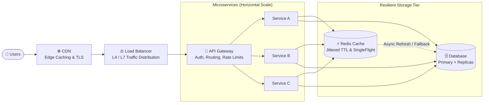
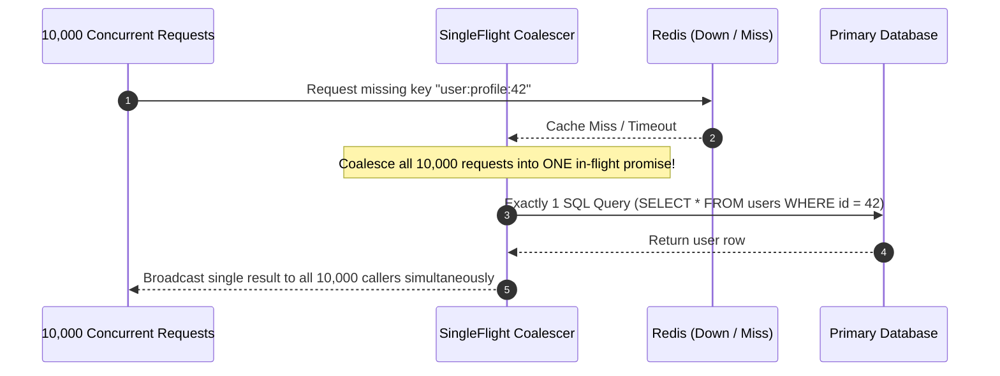

# SDCU
### *System Design · Code Context Graph · UI Craft*

[](LICENSE.md)
[](https://www.python.org/downloads/)
[](https://nodejs.org/)
[](#agent-skills-installation)

> **"Design for scale, build for resilience, secure by default, and keep your code maintainable."**

SDCU is an open-source engineering suite and multi-agent skill toolkit designed to solve the three fatal flaws of AI-generated code: **architectural collapse (SD)**, **token memory amnesia (C)**, and **vibecoded frontend slop (U)**.

---

## 🏗️ Scalable & Resilient Reference Architecture

A high-level view of a production-grade system designed with SDCU principles:



---

## 📚 System Design & Scalable Architecture Cheat Sheet

### 1. System Design Foundations (17 Essential Concepts)

| # | Concept | What It Does (Short & Effective Explanation) |
|---|---|---|
| **01** | **Load Balancing** | Distributes incoming network traffic evenly across multiple server instances to avoid overload. |
| **02** | **Caching** | Stores frequently requested data in fast memory (RAM) for sub-millisecond retrieval. |
| **03** | **CDN** | Serves static assets (images, CSS, JS) from geographically closest edge servers to minimize latency. |
| **04** | **API Gateway** | Acts as a single entry point for routing, authentication, request shaping, and global rate limits. |
| **05** | **Microservices** | Breaks monoliths into decoupled, independently deployable services organized around business domains. |
| **06** | **Monolithic Architecture** | A single deployable codebase; optimal when modularized to avoid distributed systems complexity. |
| **07** | **Replication** | Maintains synchronized copies of data across nodes for high availability and read scaling. |
| **08** | **Partitioning / Sharding** | Splits huge databases horizontally into manageable subsets across servers to scale writes. |
| **09** | **Message Queues** | Decouples services asynchronously and levels traffic spikes using buffers (e.g. Kafka, RabbitMQ). |
| **10** | **Rate Limiting** | Caps the number of requests clients can make within a time window to prevent DDoS and abuse. |
| **11** | **Consistent Hashing** | Distributes keys evenly across nodes and minimizes key remapping when nodes are added or removed. |
| **12** | **CAP Theorem** | Trade-off axiom: a distributed data store can guarantee at most two of: Consistency, Availability, Partition Tolerance. |
| **13** | **Horizontal Scaling** | Scale-Out: Adds more stateless server instances behind a load balancer to increase capacity. |
| **14** | **Vertical Scaling** | Scale-Up: Upgrades existing server hardware (CPU, RAM, NVMe) up to hardware resource ceilings. |
| **15** | **Fault Tolerance** | Enables systems to continue operating gracefully despite component or network outages. |
| **16** | **Circuit Breaker** | Stops cascading failures by failing fast with a fallback when a downstream dependency is down. |
| **17** | **Event-Driven Architecture** | Decoupled components interact via real-time asynchronous event production and consumption. |

---

### 2. Cache & Database Resilience (Preventing Stampedes)
*How to handle cache (Redis) failures without destroying the primary database.*



1. **Don't Let Every Request Hit the DB**: If Redis goes down, trip circuit breakers and throttle requests instead of letting thousands of requests hammer the database.
2. **Add Jittered Cache Expiration**: Prevent mass simultaneous cache expirations using randomized TTLs:
   $$\text{TTL} = \text{Base TTL} + \text{Random Jitter}$$
3. **Use Request Coalescing (SingleFlight)**: If 10,000 requests miss the exact same key, execute only **1 database query** and share the returned promise across all waiting clients.
4. **Warm the Cache Gradually**: When Redis reboots, do not immediately expose it to 100% of live traffic. Warm high-traffic keys gradually using controlled background workers.
5. **Protect the Database**: Impose hard ceilings on connection pool size, concurrent queries, and request queues. Apply backpressure (HTTP 429/503) when thresholds are crossed.
6. **Use Stale Data When Safe**: Serve slightly stale cached snapshots (Stale-While-Revalidate) during transient backend degraded states.

---

### 3. Security & Code Quality Checkpoints

#### 🔒 Security Guardrails (01 - 10)
| # | Issue | Production Rule & Defense |
|---|---|---|
| **01** | **API Keys in Frontend** | Never expose server secrets in client code (e.g. `NEXT_PUBLIC_*_KEY`). Proxy via backend routes. |
| **02** | **No Auth / Role Checks** | Enforce cryptographically verified tokens and strict RBAC on every state-changing route. |
| **03** | **SQL Injection Open** | Always use parameterized queries (`$1, ?`) or trusted ORMs. Never concatenate raw SQL strings. |
| **04** | **XSS (No Input Sanitize)** | Sanitize and validate all user inputs (e.g. `DOMPurify`); enforce strict Content Security Policy (CSP). |
| **05** | **Passwords Not Hashed** | Store passwords exclusively using salted, memory-hard hashes (Argon2id or bcrypt $\ge 12$). |
| **06** | **CORS * (All Origins Open)** | Never use wildcard `*` with credentials. Restrict CORS to explicit, trusted domain whitelists. |
| **07** | **.env Pushed to GitHub** | Keep secrets out of version control. Enforce `.gitignore` rules and automated pre-commit scanners. |
| **08** | **No Rate Limit** | Implement token-bucket or sliding-window rate limiters to prevent DDoS and brute-force attacks. |
| **09** | **IDOR (User/2 Data Leak)** | Always scope database lookups to the authenticated user's ID (`WHERE id = ? AND user_id = ?`). |
| **10** | **Outdated NPM Packages** | Run automated vulnerability audits (`npm audit`, Dependabot) in CI to patch known CVEs. |

#### ⚙️ Backend & Scale Best Practices (11 - 16)
| # | Issue | Production Rule & Defense |
|---|---|---|
| **11** | **No DB Schema Planning** | Design clear, scalable schemas with explicit foreign keys, indexes, and migration tracking. |
| **12** | **N+1 Queries / No Indexes** | Eliminate loops executing queries using `JOIN` or batch loaders; index all filtered and foreign keys. |
| **13** | **No Caching Layer** | Implement multi-tier caching (L1 Memory + L2 Redis) for frequently read data. |
| **14** | **Zero Error Handling** | Handle errors gracefully with typed Result patterns; never dump internal stack traces to users. |
| **15** | **No Logs / Monitoring** | Emit structured JSON logs with correlation IDs (`trace_id`) and OpenTelemetry APM traces. |
| **16** | **No Backups or Rollback** | Implement continuous WAL backups, Point-In-Time Recovery (PITR), and backward-compatible migrations. |

#### 💻 Code Quality & Rigor (17 - 20)
| # | Issue | Production Rule & Defense |
|---|---|---|
| **17** | **No Tests at All** | Maintain automated unit, integration, and critical user path tests in continuous integration. |
| **18** | **Copy-Paste, No Structure** | Organize code into modular layers (Domain, Application, Infrastructure, Presentation). |
| **19** | **Prompt Fix = New Bugs** | Validate every AI code change against automated regression tests; never accept blind edits. |
| **20** | **Can't Debug Own Code** | Keep code self-documenting, leverage structured traces, and use `sdcu graph explain` to map call trees. |

---

## 🚀 How to Use SDCU

### 1. Installation
```bash
# Clone the repository
git clone https://github.com/<your-username>/sdcu.git
cd sdcu

# Install Python Core Engine
pip install -e packages/core

# Or run via Node CLI
./packages/cli/bin/sdcu.js --help
```

### 2. CLI Commands & Capabilities

```bash
# 1. Full Master Audit (Runs SD Linter + UI Slop Auditor + Context Graph Builder)
sdcu audit

# 2. System Design & Security Audit (Scans against the 20 checkpoints)
sdcu sd audit

# 3. Export Drop-In Production Resilience Templates
sdcu sd template singleflight     # 10,000 reqs -> 1 DB query coalescing
sdcu sd template circuit-breaker  # Closed / Open / Half-Open state machine
sdcu sd template jittered-cache   # Stale-While-Revalidate with jittered TTL

# 4. Context Graph Engine (Code Memory & GraphRAG)
sdcu graph build                  # Builds AST relationship graph into .sdcu/graph.json
sdcu graph query "<question>"     # BFS traversal across codebase dependencies
sdcu graph path "<sym1>" "<sym2>" # Shortest call path between two symbols/files

# 5. UI Craft & Unslopping Audit
sdcu ui audit                     # Flags AI purple glows, neon borders, emoji spam badges
```

---

## 🤖 Agent Skills Installation

Empower your AI pair programmer (Google Antigravity, Claude Code, Cursor, Codex, OpenCode, Kilo) with the SDCU skills:

### For Google Antigravity
```bash
cp -r skills/* ~/.gemini/config/skills/
```

### For Claude Code
```bash
cp -r skills/* ~/.claude/skills/
```

### For Cursor / Codex
Add the rules from [`skills/sdcu/SKILL.md`](skills/sdcu/SKILL.md) and [`20-checkpoints.md`](skills/sdcu-sd/references/20-checkpoints.md) to your `.cursorrules` or system prompt.

---

## 📦 Production Templates Included

SDCU comes with production-grade TypeScript implementations ready to drop into your apps:
* **[`circuit-breaker.ts`](skills/sdcu-sd/templates/circuit-breaker.ts)**: Automatic trip to fallback when failure rate spikes; half-open health probe recovery.
* **[`singleflight.ts`](skills/sdcu-sd/templates/singleflight.ts)**: Request coalescing engine eliminating database stampedes.
* **[`jittered-cache.ts`](skills/sdcu-sd/templates/jittered-cache.ts)**: Jittered TTL cache with background Stale-While-Revalidate refresh.

---

## 📄 License

SDCU is free and open-source software licensed under the **[MIT License](LICENSE.md)**.
Free for all developers, commercial and personal use.
