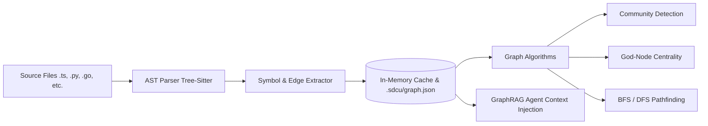

# Context Graph Architecture & GraphRAG Pipeline

## Pipeline Overview



## Node Schema
```json
{
  "id": "packages/core/src/auth.ts::validateSession",
  "label": "validateSession",
  "kind": "function",
  "file": "packages/core/src/auth.ts",
  "line": 42,
  "community": "auth_cluster",
  "degree": 14
}
```

## Edge Schema
```json
{
  "source": "packages/api/src/routes/login.ts::handleLogin",
  "target": "packages/core/src/auth.ts::validateSession",
  "relation": "CALLS",
  "confidence": "EXTRACTED"
}
```

## Traversal Modes
* **BFS (Breadth-First Search)**: Used for wide architectural queries (`sdcu graph query "How is authentication handled?"`). Expands context outwards across connected modules within a token budget.
* **DFS / Shortest Path**: Used for tracing a direct pipeline from user input to database mutations (`sdcu graph path RouteHandler DatabaseModel`).

